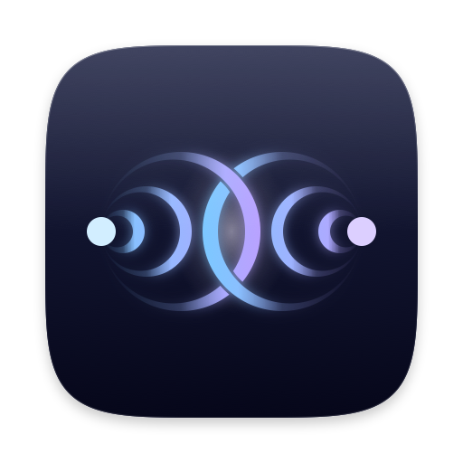
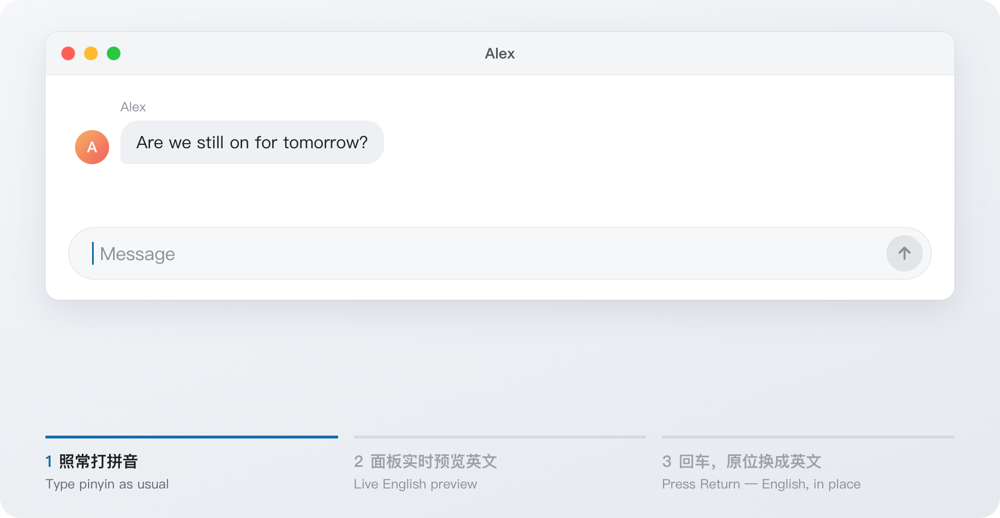

<div align="center">
  
  <h1>KEYI 可译</h1>
  <p><strong>打中文，出英文。在哪里输入，就在哪里翻译。</strong></p>
  <p><em>Type Chinese, get English — right where you type.</em></p>
  <p>
    <a href="https://github.com/oisano11/KEYI/actions/workflows/ci.yml"></a>
    
    <a href="LICENSE.md"></a>
    <a href="https://github.com/oisano11/KEYI/stargazers"></a>
  </p>
  <p>
    <a href="#三步上手">三步上手</a> ·
    <a href="#六种英文风格">英文风格</a> ·
    <a href="#按住右--说话">语音输入</a> ·
    <a href="#从源码构建与安装">安装</a> ·
    <a href="#数据与隐私">隐私</a> ·
    <a href="#english">English</a>
  </p>
</div>

<p align="center">
  <picture>
    <source media="(prefers-color-scheme: dark)" srcset=".github/assets/demo-dark.gif">
    
  </picture>
  <br>
  <sub>示意图：照 KEYI 输入法的真实面板绘制，译文为示例。</sub>
</p>

## KEYI 输入法

**脑子里想的是中文，要写的是英文？** KEYI 输入法是一款开源免费的 **Mac 翻译输入法**：
像平常一样用拼音打中文，按回车，屏幕上出现的就是英文。不用复制粘贴，不用打开翻译网页，
不用按翻译快捷键，也不用切换输入法——**边打字边翻译，打中文自动出英文**。

在微信、浏览器、邮件、终端这些常用的输入框里，都是同一套打法。

### 三步上手

1. **照常打拼音**：确认的中文先带下划线留在输入框里，光标旁的面板实时给出英文预览。
2. **按回车出英文**：整段中文原位换成英文——只换文字，**绝不替你发送**；再按一次回车才由应用发送或换行。
3. **想保留中文**：单按 Shift（或 Esc），中文原样上屏、不翻译。

### 六种英文风格

只选「想要什么样的英文」，不用挑翻译引擎。前三种用 KEYI 自带的本机模型，文字不出你的 Mac；
后三种口语风格用你自己配置的大模型 API。

| 风格 | 适合 | 在哪翻译 |
| --- | --- | --- |
| **自然**（默认） | 日常聊天，意思准、读着顺 | 本机 · Hy-MT2 |
| **正式商务** | 邮件、报价、合同，数字条款不出错 | 本机 · Hy-MT2 |
| **贴近原文** | 尽量照原句翻，不润色 | 本机 · Hy-MT2 |
| **地道美式口语** | 像美国人发消息 | 你的大模型 API |
| **黑人英语口语** | 美国黑人日常说话的语气，不另加脏话 | 你的大模型 API |
| **英式口语** | 像英国人发消息 | 你的大模型 API |

本机模型是腾讯混元 Hy-MT2-1.8B，在 KEYI 可译设置里下载并校验后即可离线中译英。

### 按住右 ⌥ 说话

不想打字时，**按住右 ⌥ 说话**：边说边在输入框里出带下划线的中文，松开就定稿，之后和打字一样——
回车换英文，单按 Shift 保留中文。按住时按了别的键、或中途点到别处，这次录音就取消，说的话不会写进去；
密码框里不录音。

- **默认本机识别**：用随输入法打包的 SenseVoice-Small（阿里 FunAudioLLM，经 sherpa-onnx 运行），
  普通话与中英混说都能认，声音不出你的 Mac、不联网。
- **想更准可以接云端**：在 KEYI 可译「设置 → 高级 → 语音输入」选阿里云 Fun-ASR 或豆包语音识别，
  填上你自己的 API Key 就能用（按时长计费，约 1–1.2 元/小时；豆包新开通有 20 小时试用）。
  只有按住右 ⌥ 那段的声音经 KEYI 可译发给你选的服务商，Key 存在钥匙串、不进输入法；
  没配好或连不上时自动改用本机识别。

### 按键一览

| 按键 | 作用 |
| --- | --- |
| 空格 / 数字 1–7 | 选候选词（空格选首选） |
| `=` `-` 或 PageDown / PageUp | 候选翻页 |
| **回车** | 整段换成英文上屏（不发送） |
| **Shift** 或 Esc | 整段原样上屏中文 |
| **按住右 ⌥** | 说话输入，松开定稿 |
| ⌃⌥T | 暂停 / 恢复自动翻译（只在 KEYI 拼音为当前输入法时生效） |

### 为什么用 KEYI 输入法

- **不打断你**：没有翻译快捷键、没有选区、没有弹窗，打字的节奏和平时一样。
- **AI 翻译，地道不生硬**：按场合选英文风格，自然、商务、贴近原文或地道口语。
- **本地翻译，隐私不外泄**：本机风格文字不出你的 Mac；输入法本身不联网、不碰你的密钥，密码框里一律不翻译。
- **拼音输入本身就好用**：基于 Rime（librime）引擎与雾凇拼音（rime-ice）词库，中英混输顺手。
- **开源免费**：代码、词库、构建脚本全在本仓库，可以自己审查、构建和修改。

**适合谁**：和外国同事、客户实时聊天；写英文邮件、发推、回评论；外贸、跨境电商、
远程工作、留学申请——所有「会想、但懒得逐句翻」的英文写作。

### 从源码构建与安装

> [!NOTE]
> 实验版：目前只在作者本机日常使用，没有公证安装包，需要从源码构建（macOS 15+，Apple Silicon）。
> 已在 macOS 15 上的微信、浏览器、终端等常见输入框中使用；其他应用可能有光标定位或回写差异。

```sh
Scripts/build-app.sh                      # KEYI 可译（翻译服务在它里面）
IME/Scripts/build-ime.sh release          # 输入法
IME/Scripts/install-ime.sh release        # 装到 ~/Library/Input Methods，不自动启用
```

第一次构建输入法会从 GitHub 下载 sherpa-onnx 运行库（约 20 MB）和 SenseVoice 模型（约 160 MB），
按固定 sha256 校验后打进输入法包。然后在「系统设置 → 键盘 → 文字输入 → 编辑…」添加「简体中文 → KEYI 拼音」。

用法、检查和卸载见 [IME/README.md](IME/README.md)；第三方组件与词库许可见
[IME/THIRD_PARTY_NOTICES.md](IME/THIRD_PARTY_NOTICES.md)（雾凇拼音词库保留其上游 GPL-3.0 等许可）。

## KEYI 可译：桌面快捷键翻译

KEYI 可译是 macOS 和 Windows 的桌面输入翻译工具，也是 KEYI 输入法背后的翻译服务。
选中文字，或将光标留在可编辑输入框，按一次全局快捷键（macOS `⌥T`，Windows `Alt+T`），
即可翻译成目标语言并原地写回。它不替换系统输入法，也不会自动发送消息。

- **原地翻译**：优先处理选中文字；没有选区时处理当前输入框全文。结果直接写回，不会自动发送。
- **双平台使用**：macOS 菜单栏与 Windows 系统托盘入口，各自保存快捷键和偏好。
- **13 种目标语言**：中文、英语、日语、韩语、法语、德语、西班牙语、俄语、葡萄牙语、意大利语、泰语、越南语、阿拉伯语。
- **多种翻译服务**：macOS 可使用系统翻译；也可接入 DeepSeek、通义千问、火山方舟、Grok、自定义兼容服务或 KEYI 自带的本地模型。
- **语境与表达**：模型服务可按聊天、发帖、商务或贴近原文调整翻译；目标语言为英语时可选择表达风格。
- **数据边界清晰**：云端服务默认只接收待翻译文本；API Key 保存在当前用户的系统凭据存储，不写入仓库。

<details>
<summary><strong>macOS：安装实验 DMG</strong></summary>

当前实验版提供 Apple Silicon（arm64）DMG。打开 DMG 后，将“KEYI 可译”拖到 `Applications`，再从“应用程序”打开。

**第一次打开**

1. 本实验版使用本机开发签名，未经过 Apple 公证。若 macOS 提示无法验证开发者，在 Finder 中按住 Control 点按“KEYI 可译”，选择“打开”。
2. 若仍被拦截，先尝试打开一次，然后到“系统设置 → 隐私与安全性”底部选择“仍要打开”，再重新打开应用。不要关闭 Gatekeeper 或执行来历不明的终端命令。
3. 打开 KEYI 的“设置 → 通用”，授予“辅助功能”权限；也可在“系统设置 → 隐私与安全性 → 辅助功能”中启用 KEYI 可译。授权后退出并重新打开 KEYI。

**使用系统翻译**

系统翻译不需要 API Key。在“设置 → 翻译服务”选择“系统翻译”，再选择目标语言。

- 第一次使用某个语言组合时，macOS 需要下载对应的翻译语言资源。保持联网，按系统提示选择下载或继续，等待下载完成后再次翻译。
- 翻译资源由 macOS 管理，KEYI 不会自行下载或保存语言包。系统未提供该语言组合、下载失败或长期无响应时，可稍后联网重试，或改用云端翻译服务。
- 系统翻译只使用目标语言，不应用 KEYI 的“使用场景”和“表达风格”。

**常见限制**

- 密码框、只读区域和部分自绘输入框不能读取或写回文字；先在普通可编辑输入框测试。
- 翻译过程中切换窗口、移动光标或继续输入会取消写回，避免覆盖新内容。
- 更换或重新复制应用后，macOS 可能要求再次确认辅助功能权限。

</details>

<details>
<summary><strong>macOS：从源码构建与签名</strong></summary>

需要 macOS 15 或更高版本与 Xcode Command Line Tools：

```sh
Scripts/test.sh
Scripts/build-app.sh
```

构建产物为 `.build/KEYI 可译.app`。首次使用时，在“系统设置 → 隐私与安全性 → 辅助功能”中允许 KEYI 可译。

默认构建仅用于本机开发：使用本机钥匙串里的 Apple Development 证书签名（免费的 Xcode 个人团队即可生成），找不到时使用 ad-hoc 签名。两者都不能作为受支持的正式分发包。源码 Release 不需要 Apple 证书。

macOS 正式二进制发布前，必须加入 Apple Developer Program，在开发者后台登记 Bundle ID `com.keyi.input-translator`，创建并安装 `Developer ID Application` 证书，然后显式执行：

```sh
KEYI_SIGNING_MODE=distribution Scripts/build-app.sh
```

该模式找不到证书会直接失败，不会静默退回 ad-hoc。签名完成后仍需使用 `notarytool` 提交公证并用 `stapler` 固化票据，才能作为受支持的公开安装包。私钥只应留在签名者或受控 CI 中，不要发送给他人。

</details>

<details>
<summary><strong>Windows</strong></summary>

需要 .NET 8 SDK、NSIS 与 7-Zip：

```sh
Scripts/build-windows.sh
```

如需同时生成 macOS/Windows 实验二进制，可执行：

```sh
Scripts/package-experimental-binaries.sh
```

详细说明见 [Windows/README.md](Windows/README.md)。稳定的 `v1.1.6` Release 仍以源码为主；`v1.1.7-binary-preview.1` 提供 macOS DMG/ZIP 与 Windows 安装器，均为未公证或未受平台发行者信任的实验二进制，不提供自动更新或官方安装支持。

</details>

## 数据与隐私

**KEYI 输入法**

- 输入法进程本身不联网、不持有任何密钥；确认的中文经本机 socket 交给 KEYI 可译翻译。
- 只翻译你用 KEYI 拼音新确认的中文；拼音、未确认的候选、其他输入法的内容和聊天历史都不会送去翻译。
- 密码与安全输入里是普通拼音，不翻译、不录音、不发任何请求。
- 语音输入默认在本机识别，声音只在内存里、不保存；只有你在设置里选了云端识别时，按住右 ⌥ 期间的声音才会发给你选的服务商（阿里云或豆包）。

**KEYI 可译**

- API Key 保存在当前用户的系统凭据存储（macOS 钥匙串、Windows 凭据管理器），不写入仓库。
- 使用云端翻译时，KEYI 可译只向你选择的服务发送待翻译文字。
- 本地模型是 KEYI 自带的 Hy-MT2-1.8B：由你在设置里下载并校验 sha256，KEYI 打包官方 llama.cpp `llama-server` 运行，只走本用户 UNIX socket 加随机密钥，不对外监听。
- 本地模型模式可在本机使用完整输入框上下文以改善语境；该内容不离开本机。
- macOS 仅从辅助功能接口读取可确认的选区；完全不暴露文本的控件不再通过剪贴板猜测来源。
- 终端替换中断后，可从 KEYI 菜单复制保留的原命令，再手动恢复；退出应用会清除尚未取回的原命令。
- 请勿在密码框、只读区域或不允许处理敏感内容的输入框中使用。

## 状态

- **KEYI 输入法**：实验版，只在作者本机日常使用；没有公证安装包，需从源码构建（macOS 15+，Apple Silicon）。
- **Windows、Android、iOS 版输入法**：正在开发，源码暂未公开。
- **KEYI 可译**：源码版本 1.1.8。实验二进制只用于自愿测试；Windows 10/11 真机的安装、升级、重启和签名验证仍未完成，macOS 实验包也未通过 Gatekeeper 公证。

## English

**KEYI Pinyin is a free, open-source AI translation keyboard for Mac.** Type Chinese in pinyin,
press Return, and get natural English right where you type. No copy-paste, no translator tab,
no hotkey — just translate as you type.

- **How it works:** confirmed Chinese stays underlined in the text field while a panel next to the
  cursor previews the English live. Press Return and the whole passage is replaced with English in
  place — it is never sent for you. Press Shift (or Esc) to keep the Chinese instead.
- **Six English styles:** Natural (default), Business and Close to Original run on-device with
  Tencent Hunyuan Hy-MT2, so your text never leaves your Mac. Casual American, Black American Casual
  and British Casual use a large-language-model API you configure yourself.
- **Voice input:** hold the right ⌥ key and talk — Chinese appears underlined as you speak, and Return
  turns it into English just like typed text. Recognition runs on your Mac by default (SenseVoice-Small
  via sherpa-onnx, offline); you can switch to Aliyun Fun-ASR or Doubao ASR with your own API key.
  Only the audio you hold ⌥ for is sent, and KEYI falls back to on-device recognition when the cloud
  is unavailable.
- **Private by design:** the input method itself never touches the network or your keys, and password
  fields are never translated or recorded.
- **Built on** Rime (librime) and rime-ice for pinyin input.

**Great for:** chatting with English-speaking colleagues and clients, writing English emails and
social posts, cross-border sales and remote work — anyone who thinks in Chinese but writes in
English on macOS.

**Status:** experimental. Build from source on macOS 15+ (Apple Silicon) with the three commands under
[Build & install](#从源码构建与安装); see [IME/README.md](IME/README.md) for details.
Windows, Android and iOS versions of the input method are in development and not yet open-sourced.

**Also in this repo — KEYI Desktop Translator** for macOS and Windows: select text, or place the cursor
in an editable field, press a global shortcut (`⌥T` / `Alt+T`), and the translation is written back in
the same app. 13 target languages; system translation, cloud providers or the bundled local model.

## 致谢

KEYI 站在这些开源项目上：
[Rime / librime](https://github.com/rime/librime) ·
[雾凇拼音 rime-ice](https://github.com/iDvel/rime-ice) ·
[Ni 输入法](https://github.com/xiaomaolu/ni-input-method-open-source) ·
[腾讯混元 Hy-MT2](https://huggingface.co/tencent/Hy-MT2-1.8B-GGUF) ·
[llama.cpp](https://github.com/ggml-org/llama.cpp) ·
[SenseVoice](https://github.com/FunAudioLLM/SenseVoice) ·
[sherpa-onnx](https://github.com/k2-fsa/sherpa-onnx) ·
SCOWL。各组件保留原许可，见 [IME/THIRD_PARTY_NOTICES.md](IME/THIRD_PARTY_NOTICES.md)。

## 许可、社区与合作

本项目采用 [Apache License 2.0](LICENSE.md)，允许商业使用、修改和再发布。再发布时请保留版权声明和许可证文本；
修改过的文件应注明修改。Apache-2.0 不授予 KEYI 的商标或品牌使用权。

欢迎提交 [Issue](https://github.com/oisano11/KEYI/issues) 报告问题或提出建议。首次公开阶段暂不接收 Pull Request；
商业合作、官方支持和定制服务请联系 oisano@icloud.com。
